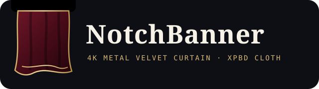
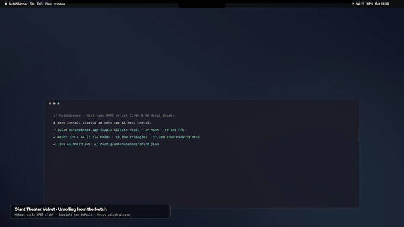
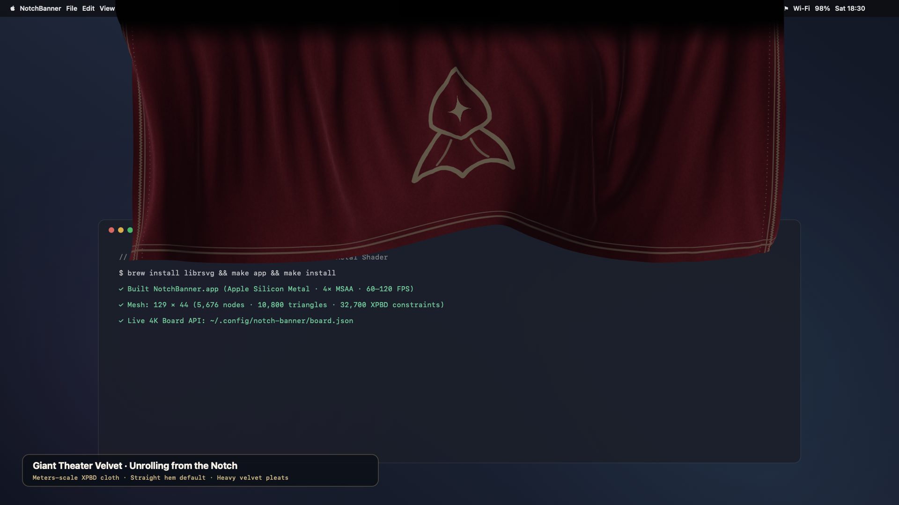
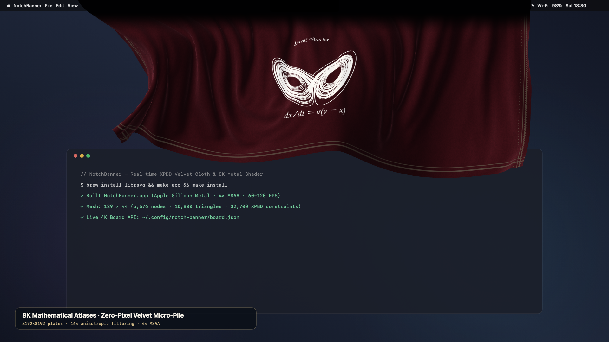
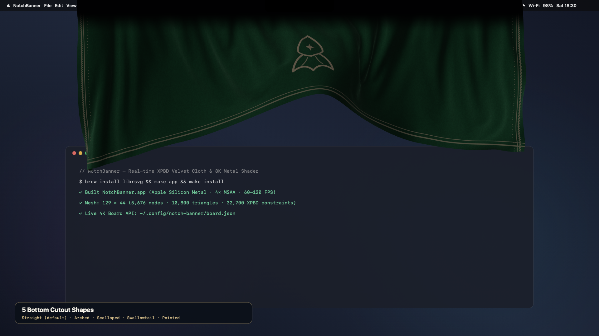
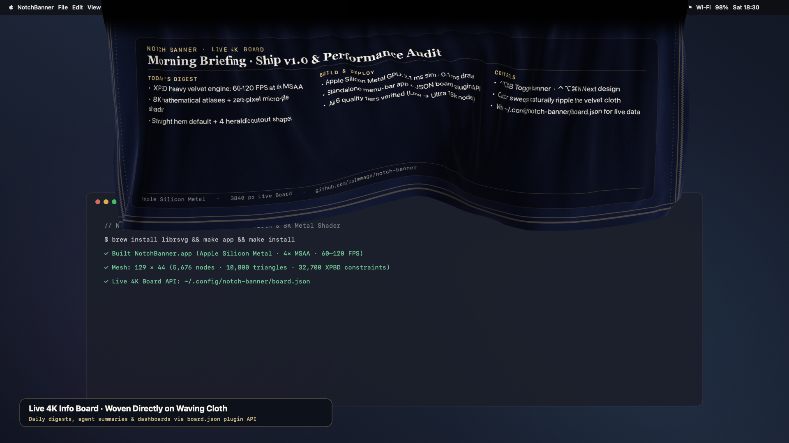
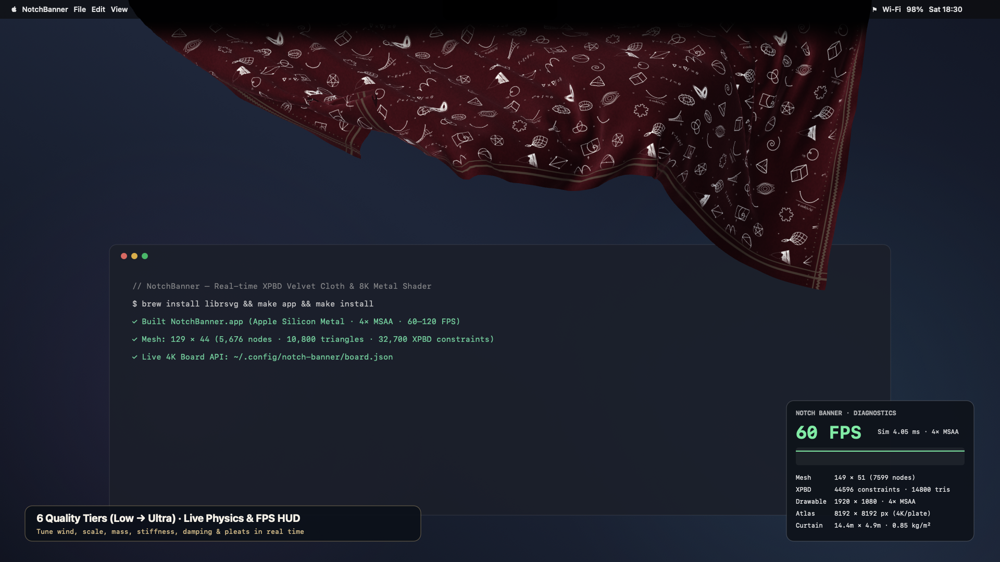

<p align="center">
  
</p>

<p align="center">
  <strong>A giant 4K velvet theater curtain &amp; live info board hanging from your macOS notch — simulated in real-time Metal XPBD cloth physics at 60–120 FPS.</strong>
</p>

<p align="center">
  <a href="https://github.com/calmmage/notch-banner/releases/latest">Download macOS App</a> ·
  <a href="#live-4k-info-board--plugin-api">Live 4K Info Board</a> ·
  <a href="#quality-tiers--physics-controls">Quality &amp; Physics</a> ·
  <a href="#build--install">Build from Source</a>
</p>

---

### Install on your Mac

Paste this command into Terminal. It downloads the universal macOS 13+ app, verifies the release archive, and starts the flag in your menu bar. It installs in your Applications folder and starts at login. A Metal-capable Mac is required.

```bash
curl -fsSL https://github.com/calmmage/notch-banner/releases/download/v1.2.0/setup-mac.sh | /bin/bash
```

Click the flag to open **Banner Studio → Now (Live)**. **Position** moves the curtain left or right within the space beside it. **Split the middle** opens a gap between two independent panels. Choose **Mesh** to grab a knot with the left mouse button or cut strands with a right-button drag. On a trackpad, hold a secondary click while dragging. **Mend net** restores the strands. Other prints let clicks pass through to your desktop.

New prints include mandala, Poincaré grid, sumi-e ink, guilloché, mosaic, seigaiha waves, and botanical sketch. [Watch the interaction demo](https://github.com/calmmage/notch-banner/releases/download/v1.2.0/interactions.mp4).

---

### Demo (1080p60, Apple Silicon Metal)

> Watch the full 30-second 1080p60 demo: [`assets/demo.mp4`](assets/demo.mp4) (also attached to the [latest release](https://github.com/calmmage/notch-banner/releases/latest)).

<p align="center">
  
</p>

---

### Gallery

| Giant Theater Velvet (Straight Hem) | 8K Mathematical Plates (Zero-Pixel Micro-Pile) |
|---|---|
|  |  |

| 5 Bottom Cutout Shapes | Live 4K Editorial Info Board |
|---|---|
|  |  |

<p align="center">
  
</p>

---

### Why NotchBanner?

Most notch utilities put static pills around the camera cutout. **NotchBanner** turns your MacBook notch into a physical stage rod draped with a monumental, heavy velvet theater curtain — simulated in real meters with XPBD constraints, weighted hem chains, aerodynamic wind combat, cursor brushing, 8K mathematical atlases, and a **4K live typography board** that bends naturally with every fold.

- **Giant Theater Velvet Physics**: Real-world meter-scale XPBD cloth (`0.85 kg/m²` stage velvet, weighted hem, long-range attachment tethers against vertical sag, deep vertical pleats, strong multi-front wind that visibly fights the curtain's inertia).
- **Zero-Pixel 4K+ Textures**: Physical-scale procedural velvet micro-pile & damask (zero blocky cells even across 5K displays), `8192×8192` mathematical atlases (`4K×4K` per plate), `16×` anisotropic filtering, and `4× MSAA`.
- **5 Bottom Cutout Shapes**: **Straight (no cutout)** by default so the velvet waves freely, plus **Swallowtail (V-cut)**, **Pointed (Pennant)**, **Arched**, and **Scalloped** — all with matching antique-gold double-braid hem trim.
- **Live 4K Info Board Plugin API**: Render daily digests, CI dashboards, or custom status briefings directly onto the waving velvet via `~/.config/notch-banner/board.json` or `--text`.
- **Hover Transparency**: Smoothly fades transparent when your mouse hovers over the curtain (`22%`), and fades even further (`8%`, including the top collar) near the top border so menu bar icons and browser tabs stay completely readable and clickable.
- **Persistent Banner Studio Window**: Left-click the menu bar flag to open a persistent 3-tab floating window (**Now (Live)** · **Physics & Quality** · **Random Rotation**) — stays open while you tweak live patterns, colours, cutouts, arbitrary width/height/opacity sliders, presets (including **Ultra Short** thin top valance), physics, and rotation pools. Right-click for the quick menu.
- **6 Quality Tiers + Live Physics Controls + FPS Diagnostics HUD**: Tune `Low → Ultra` (up to 16,000 nodes & 120 Hz ProMotion), wind strength, physical scale, mass, stiffness, damping, and pleat fullness with a live FPS sparkline HUD.
- **Click-Through & Native**: Pure Swift + Metal with click-through fabric and an interactive Mesh mode, zero Electron, zero external runtime dependencies.

---

### Quality Tiers & Physics Controls

Open **Flag menu → Physics & Settings…** or **Diagnostics HUD (FPS)**:

| Tier | Quad Spacing | Max Nodes | Substeps × Iters | Target FPS | MSAA | Render Budget |
|---|---:|---:|---:|---:|---:|---:|
| **Low** | 28 pt | 900 | 2 × 2 | 30 | 1× | 3.7 MP |
| **Med** | 20 pt | 2,000 | 2 × 2 | 30 | 1× | 6.2 MP |
| **High** *(default)* | 14 pt | 4,800 | 3 × 2 | 60 | 4× | 10.5 MP |
| **XHigh** | 11 pt | 7,500 | 4 × 2 | 60 | 4× | 14.7 MP |
| **Max** | 9 pt | 11,000 | 4 × 3 | 60 | 4× | 18.0 MP |
| **Ultra** | 7 pt | 16,000 | 5 × 3 | 120 | 4× | 24.0 MP |

**Tunable physics parameters** (persisted in `~/.config/notch-banner/config.json`):
- **Wind** (`0.0× – 3.0×`) + one-click **Send Wind Gust**
- **Size / Scale** (`0.5× – 2.5×`, physical meter scale — larger = heavier, slower, grander theater waves)
- **Mass** (`0.25 – 2.0 kg/m²`, from light silk to monumental velvet)
- **Stiffness** (`0.3× – 2.5×`, plush curvature resistance)
- **Damping** (`0.2 – 2.0`, internal fabric hysteresis)
- **Pleats** (`0.0× – 1.6×`, vertical drapery fullness)

---

### Live 4K Info Board & Plugin API

Write a JSON file to `~/.config/notch-banner/board.json` (or pass `--board file.json` / `--text "Title\nBullet"`):

```json
{
  "eyebrow": "DAILY BRIEFING",
  "title": "Ship v1.0 · All 14 Checks Green",
  "sections": [
    {
      "heading": "FOCUS",
      "items": [
        "Benchmark Ultra preset on ProMotion",
        "Review open pull requests"
      ]
    },
    {
      "heading": "STATUS",
      "items": [
        "CI main: passing",
        "Zero pending alerts"
      ]
    }
  ],
  "footer": "Updated live · 4K Metal Velvet Board"
}
```

```bash
# Quick CLI text onto the waving 4K curtain
./build/NotchBanner --text "Deploy Complete\nAll services healthy on production"

# Or load a custom JSON board
./build/NotchBanner --board ./my-dashboard.json
```

---

### Keyboard Shortcuts

| Shortcut | Action |
|---|---|
| `⌃⌥⌘ B` | Show / hide banner (unrolls from top rod) |
| `⌃⌥⌘ N` | Next pattern / colour / width / cutout |
| `⌃⌥⌘ H` | Cycle height (`Short` → `Half` → `Full`) |
| `⌃⌥⌘ T` | Cycle opacity (`100%` → `72%` → `46%`) |

Move your cursor across the banner at any time to physically brush and ripple the velvet.

---

### Build & Install

Requires macOS 13+ with Apple Silicon / Metal GPU and Xcode Command Line Tools (`swiftc`). Optional: `brew install librsvg` to regenerate the `8192×8192` mathematical atlases from vector equations.

```bash
git clone https://github.com/calmmage/notch-banner.git
cd notch-banner

# Build NotchBanner.app
make app

# Or install to /Applications + LaunchAgent (starts at login)
make install
```

To regenerate the 8K mathematical atlases or record a local 1080p60 Metal demo video:

```bash
make textures     # regenerates Resources/banner-math.png & banner-plates.png at 8192x8192
make demo         # renders a 30s 1080p60 Metal showcase video to assets/demo.mp4
```

---

### License

MIT — see [LICENSE](LICENSE).
